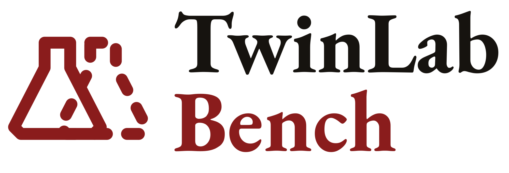
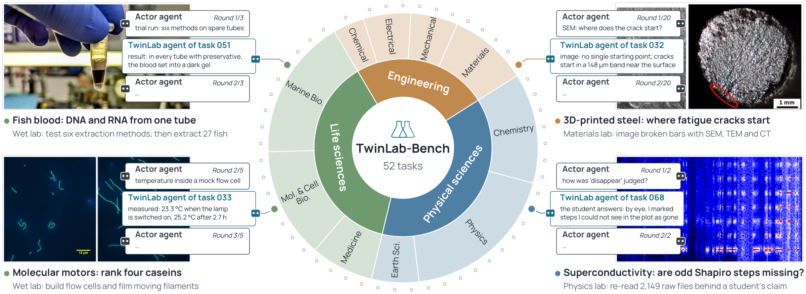

<h1 align="center">TwinLab-Bench: Evaluating AI Scientists in Agentic Twins of Real Labs</h1>

<br>

<p align="center">
  <picture>
    <source media="(prefers-color-scheme: dark)" srcset="assets/twinlab-bench-logo-dark.png">
    
  </picture>
  <br>
  <br>
</p>

<p align="center">
  <a href="https://zjuscl.github.io/TwinLab-Bench"></a>
  <a href="https://huggingface.co/spaces/ZJUSCL/TwinLab-Bench_Leaderboard"></a>
  <a href="https://zjuscl.github.io/TwinLab-Bench/#all"></a>
  <a href="https://huggingface.co/datasets/ZJUSCL/TwinLab-Bench"></a>
</p>

## Overview

[TwinLab-Bench](https://zjuscl.github.io/TwinLab-Bench) is a benchmark that evaluates AI scientists on experiments that they design themselves. Each task comes from the records of a real laboratory. The agent receives the notebooks, raw data, and interim conclusions that the laboratory had at one point of its work, requests the experiments that it designs within a budget, and submits a report. The report is scored by comparison with a hidden answer taken from what the laboratory later found.

Each task has its own TwinLab agent, which serves as the environment and executes the experiments that the tested agent designs. The TwinLab agent returns the recorded result for an experiment that the laboratory performed, and runs calculators built from the records of the laboratory for the other experiments.

These tasks remain hard for frontier models, and the strongest model, Claude Fable 5.2, averages a score of 45.0 out of 100. Compare models on the [leaderboard](https://huggingface.co/spaces/ZJUSCL/TwinLab-Bench_Leaderboard), browse every task and one run of it on the [task dashboard](https://zjuscl.github.io/TwinLab-Bench/#all), and download the tasks from [Hugging Face](https://huggingface.co/datasets/ZJUSCL/TwinLab-Bench). To report a problem with a task, [open an issue](https://github.com/ZJUSCL/TwinLab-Bench/issues).

## Task Coverage

TwinLab-Bench contains **52** tasks from laboratories in the physical sciences (20 tasks), the life sciences (20 tasks), and engineering (12 tasks). The [task dashboard](https://zjuscl.github.io/TwinLab-Bench/#all) lists all of them.

<p align="center">
  
</p>

## Running the Benchmark

### Setup

You need Linux with [bubblewrap](https://github.com/containers/bubblewrap), Python 3.11 or later, Claude Code, and a DeepSeek API key. Claude Code needs to be signed in only when a Claude model is the actor. Codex is needed only for GPT actors. `machine.example.yaml` lists the Claude Code and Codex versions that we tested.

```bash
hf download ZJUSCL/TwinLab-Bench --repo-type dataset --local-dir TwinLab-Bench
cd TwinLab-Bench
pip install -r requirements.txt
cp machine.example.yaml machine.yaml   # edit the paths in this file
mkdir -p ~/.config/twinlab/claude-ds
```

DeepSeek-flash serves as the TwinLab agent and the judge agent through Claude Code. By default Claude Code calls DeepSeek's Anthropic-format API at `https://api.deepseek.com/anthropic` (set `DEEPSEEK_BASE_URL_ANTHROPIC` for another endpoint).

```bash
export DEEPSEEK_API_KEY=sk-...
```

(Optional) For an endpoint that accepts only the OpenAI format, set `DEEPSEEK_BASE_URL_OPENAI` and start the local proxy, which converts the requests.

```bash
export DEEPSEEK_BASE_URL_OPENAI=https://api.deepseek.com
python scripts/llm_proxy.py write-config --model deepseek-flash --upstream-model deepseek-flash \
  --api-base $DEEPSEEK_BASE_URL_OPENAI --key-env DEEPSEEK_API_KEY \
  --master-key sk-local-twinlab --config ~/.config/twinlab/litellm.yaml
python scripts/llm_proxy.py start --config ~/.config/twinlab/litellm.yaml --port 4001 --workers 32
```

### Run

Run one task.

```bash
python scripts/run_case.py --case cases/029-die-attach-release-01/case.yaml --n-runs 1 \
  --actor-agent claude-code --actor-model claude-opus-5-5 --actor-effort high \
  --env-model deepseek-flash --judge-model deepseek-flash \
  --actor-timeout-s 10800 --checkpoints case --out runs
```

Run all 52 tasks. The script prints a table of scores and writes each run to `runs/<task>/<time>/run_0/`, where `result.json` holds the score.

```bash
python scripts/run_batch.py --cases cases/*/case.yaml --n-runs 1 \
  --actor-agent claude-code --actor-model claude-opus-5-5 --actor-effort high \
  --env-model deepseek-flash --judge-model deepseek-flash \
  --actor-timeout-s 10800 --checkpoints case --jobs 52 --out runs \
  --env-check-scratch /tmp/twinlab_env_check
```

A run that stops on an error continues with `python scripts/resume_run.py --run-dir <run dir>`. To test another model, use `--actor-agent codex` for GPT models, or add the model to `model_backends` in `machine.yaml` and keep `--actor-agent claude-code`.

## Citation

If you find this work useful, please cite it.

```bibtex
@article{wan2026twinlabbench,
  title  = {{TwinLab-Bench}: Evaluating {AI} Scientists in Agentic Twins of Real Labs},
  author = {Wan, Yang and Zhu, Linchao},
  year   = {2026},
  url    = {https://zjuscl.github.io/TwinLab-Bench}
}
```

## Contact

For questions and feedback, contact [wanyang@zju.edu.cn](mailto:wanyang@zju.edu.cn).

## Acknowledgements

TwinLab-Bench is built on the records of real laboratories. We thank the researchers who published the lab notebooks, raw data, and papers that the tasks come from, and the data providers who answered our emails and allowed us to reuse their records. Every task uses its source records under the terms of their licenses. The task table in the appendix of our paper lists the source records and papers of every task, and the bibliography of the paper gives their full references. If you use a task, please also cite its sources from this bibliography.
